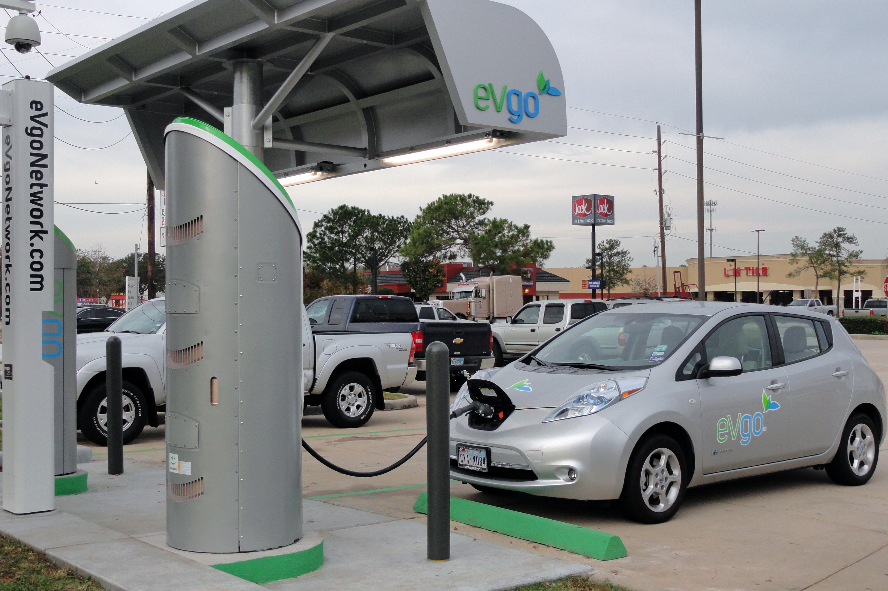
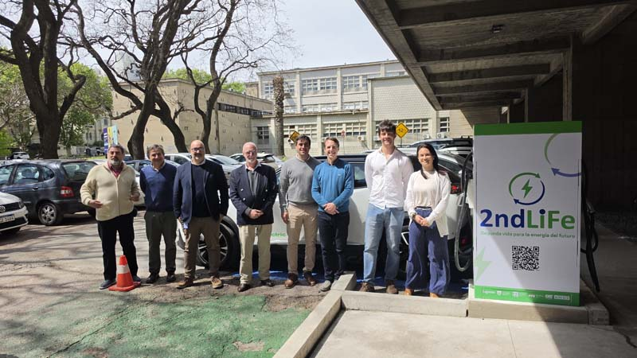
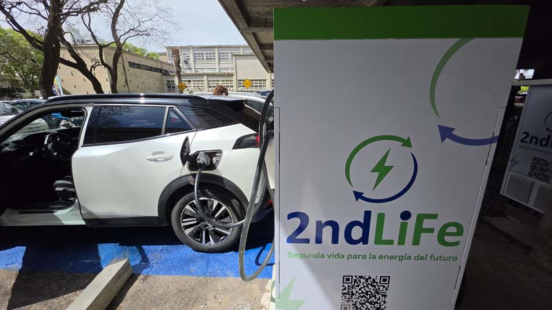

<!-- _footer:  --> 
<!-- _paginate: false -->
<!-- _class: titleSlide -->

# Electromovilidad: gestionar la red, no solo generar energía

## Andrés Ferragut - Universidad ORT Uruguay

### XLVIII Reunión de Trabajo de ASADES
### Panel "Electromovilidad y baterías de segunda vida"
### Salto, noviembre 2026

---
<!-- paginate: true -->
<!-- class: normalSlide -->

# Algunos números (2025)

* Se vendieron **961.000 $m^3$** de gasolinas: unos **12.700 millones de km** (a 13,2 km/l).
* Sustituirlos requeriría del orden de **2.000 GWh/año** (a ~0,16 kWh/km).
* Es **~16 %** de lo volcado al SIN en 2025 (13.040 GWh).
* Exportaciones: **~1.000 GWh** en 2025 y **~2.000 GWh** en 2024, un buen año hidrológico.

**Supuestos:** solo gasolinas (el gasoil liviano agregaría ~25-30 %). Rendimiento 13,2 km/l (Encuesta DNE-AECID 2014). Consumo 0,16 kWh/km: ~0,13 (4 BEV más vendidos en 2025, ponderado por ventas) + ~10 % de pérdidas de carga + margen por vehículos más grandes. Rango: 1.600-2.600 GWh (12-20 %). **Fuentes:** ANCAP, Memoria 2025; MIEM-DNE, Balances Preliminares 2024 y 2025 (exportaciones 2024: 174 ktep).

---
# La energía está, el desafío es la red

<h2 style="color: rgb(20,50,100); text-align: center; font-size: 1.3em; margin-top: 30px;"> La energía necesaria es una fracción acotada de la generación actual. El desafío está en <i>cuándo</i> y <i>dónde</i> se carga. </h2>

* ~2.000 GWh/año son unos 5,6 GWh por día. Cargados en una ventana nocturna de 8 h: del orden de **700 MW** adicionales, frente a un máximo de demanda del sistema de ~2.500 MW.
* Si toda la carga fuera domiciliaria, sería del orden de **+45 %** sobre el consumo residencial de UTE.
* La **carga rápida** concentra mucha potencia en un solo punto: puede exigir reforzar la conexión.

<b>Hay que gestionar la red para evitar la congestión, sin depender de grandes inversiones.</b>

Cálculos ilustrativos: carga uniforme en 8 h; máximo de demanda 2.507 MW (7/3/2025, BEN 2025); consumo residencial UTE 4.488 GWh en 2024 (INE, Anuario Estadístico 2025, suma de tarifas residenciales).

---

# Una alerta desde Europa: Países Bajos

* Más de **14.000** grandes consumidores esperan conexión a la red: casi **+20 %** en un año.
* Desde el 1/7/2026, las conexiones para **cargadores públicos no tienen prioridad** en la cola.
* Nuevas conexiones de carga pública: 11.898 en 2023 (año pico), **5.172** en el primer semestre de 2026. Se espera que se estanquen.
* TNO advierte que la congestión puede **frenar la transición** y propone gestión inteligente de la red y ubicación estratégica de cargadores.

<h3 style="color: rgb(20,50,100); margin-top: 0;">Uruguay</h3>

* Generación con margen: el parque liviano requeriría ~16 %.
* Red pública de carga en expansión.
* **Estamos a tiempo de anticiparnos:** gestionar la red antes de que la congestión sea un problema.

Fuentes: TNO, *The impact of grid congestion and a waiting list on the mobility transition* (noviembre 2025); Netbeheer Nederland, informe de avance del programa de congestión (octubre 2026, vía Solar Magazine).

---

# Nuestro equipo:

Grupo de Matemática Aplicada a Telecomunicaciones y Energía

Universidad ORT Uruguay

 

**Investigadores:**

 * Fernando Paganini (SNI Nivel III)
 * Andrés Ferragut (SNI Nivel II)

**Colaborador:**

 * Enrique Briglia

<!-- TODO (Andrés): agregar colaboradores y la colaboración con el Faraday Lab (FIng-Udelar). -->

---

# 2ndLife: segunda vida para baterías de vehículos eléctricos

**Idea:** reutilizar baterías de vehículos eléctricos fuera de circulación como almacenamiento junto a un **cargador rápido**.

* La batería aporta energía en los picos de carga, **sin aumentar la potencia tomada de la red**.
* Permite instalar carga rápida donde la red existente no tiene capacidad suficiente.
* Extiende la vida útil de la batería: **economía circular**.

**Socios:**

* Faraday Lab, Facultad de Ingeniería, Udelar
* Facultad de Ingeniería, Universidad ORT Uruguay
* Ingener S.A.

**Financiamiento:** ANII, Proyectos Innovadores de Crédito Fiscal.

**Prototipo inaugurado** el 22/10/2026 en FIng-Udelar.

---

# 2ndLife

<!-- Fotos: guardarlas como images/2ndlife_1.jpg e images/2ndlife_2.jpg (o cambiar los nombres acá). -->

---

# El prototipo

<b>Red</b> máx. 40 kW

&rarr;

<b>Control</b> balancea red y batería

&#8645;

<b>Batería reutilizada</b> 30 kWh

&rarr;

<b>Cargador DC</b> 60 kW

* Batería de **30 kWh** recuperada de un vehículo siniestrado y cargador rápido DC de **60 kW**.
* El algoritmo de control balancea los aportes de la red (**máx. 40 kW**) y de la batería para sostener la potencia del cargador **sin exigir a la red**.
* La batería se recarga durante los períodos sin uso.

---

# Cómo funciona

En cada instante, la potencia entregada al vehículo se reparte entre red y batería:

$$
P_{\text{cargador}}(t) = P_{\text{red}}(t) + P_{\text{bat}}(t), \qquad P_{\text{red}}(t) \le 40 \text{ kW}.
$$

**Con un vehículo cargando a 60 kW:**

* La red aporta 40 kW y la batería, los 20 kW restantes.
* Con 30 kWh, la batería sostiene la carga a plena potencia del orden de **1,5 h** (cálculo ideal).

**Sin vehículos:**

* La batería se recarga desde la red, dentro del mismo límite.
* Recargarla por completo lleva del orden de **45 min** a 40 kW (cálculo ideal).

Tiempos ideales: sin pérdidas, sin límites de estado de carga ni curvas de carga del vehículo. El prototipo está recién inaugurado; la validación en condiciones reales es la próxima etapa.

---

# ¿Por qué tiene sentido en Uruguay?

* **El parque eléctrico crece rápido:** unos 35.000 vehículos eléctricos en circulación y 20 % de los 0 km vendidos en 2025. Eso implica una oferta creciente de baterías usadas y de vehículos siniestrados.

* **La red de carga pública se expande:** UTE tiene 531 puntos de carga (367 DC) y apunta a 1.000 en 2027. La capacidad de la red en cada sitio es uno de los criterios para ubicarlos.

* **Mucha generación renovable variable:** con una matriz ~98 % renovable, recargar la batería en horas de baja demanda aprovecha energía de bajo costo.

* **Evita reforzar la conexión:** un cargador de 60 kW puede operar con una conexión de 40 kW, en lugar de exigir a la red la potencia completa.

Fuentes: Presidencia/UTE (setiembre 2026, parque y red de carga); Ámbito (julio 2026, criterios de UTE para ubicar cargadores); ACAU (ventas 2025); MIEM-DNE (Balance Energético Nacional 2025).

---

# Conclusiones

* La energía para electrificar el parque liviano es una fracción acotada de la generación: **el desafío es la red**.

* Europa ya enfrenta la congestión. En Uruguay estamos a tiempo de anticiparnos *gestionando* la red.
  
* **2ndLife:** baterías reutilizadas y control para sumar carga rápida sin reforzar la red.

* **Próximo paso:** validar el prototipo en condiciones reales.
  

 
 

---

<!-- _footer:  --> 
<!-- _paginate: false -->
<!-- _class: titleSlide -->

# Muchas gracias

## Contacto: ferragut@ort.edu.uy

## Website: https://aferragu.github.io
