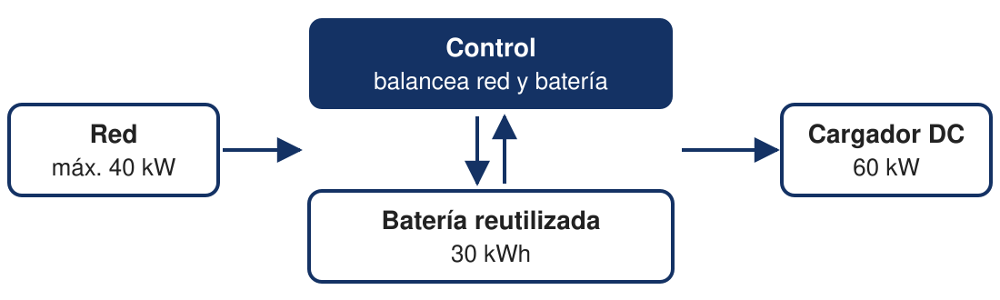

<!-- _footer:  --> 
<!-- _paginate: false -->
<!-- _class: titleSlide -->

# Electromovilidad: desafíos para la red eléctrica.

## Andrés Ferragut - Universidad ORT Uruguay

### XLVIII Reunión de Trabajo de ASADES
#### Panel "Electromovilidad y baterías de segunda vida"
#### Salto, noviembre 2026

---
<!-- paginate: true -->
<!-- class: normalSlide -->
<!-- _class: normalSlide conNota -->

# La energía está

## ~2.000 GWh/año

para sustituir toda la gasolina del país por electricidad

### ≈ 16 % de la generación

del orden de lo que se exporta en un buen año hidrológico

> **Supuestos:** 961.000 m³ de gasolinas (ANCAP, 2025) a 13,2 km/l (Encuesta DNE-AECID 2014) = ~12.700 millones de km; 0,16 kWh/km (4 BEV más vendidos en 2025 + ~10 % de pérdidas de carga + margen por vehículos más grandes). Generación volcada al SIN: 13.040 GWh (MIEM-DNE, 2025). Rango: 1.600-2.600 GWh (12-20 %). No incluye gasoil liviano (~+25-30 %).

<!--
Notas:
- 961.000 m³ de gasolinas vendidas en 2025 (ANCAP) → ~12.700 millones de km a 13,2 km/l.
- A ~0,16 kWh/km → ~2.050 GWh/año.
- Generación volcada al SIN 2025: 13.040 GWh → ~16 %.
- Exportaciones: ~1.000 GWh en 2025; ~2.000 GWh en 2024 (174 ktep, BEP 2024).
-->

---
<!-- _class: normalSlide conNota mensaje -->

# El desafío es la red: cuándo y dónde se carga

* Si todos cargan de noche: del orden de **700 MW** adicionales, frente a un máximo del sistema de ~2.500 MW.

* La **carga rápida** concentra mucha potencia en un solo punto de la red.

### Hay que gestionar la red para evitar la congestión, sin depender de grandes inversiones.

> Cálculo ilustrativo: ~2.000 GWh/año cargados uniformemente en una ventana de 8 h. Máximo de demanda: 2.507 MW (7/3/2025, BEN 2025).

<!--
Notas:
- ~2.000 GWh/año son ~5,6 GWh por día; en 8 h → ~700 MW.
- Si toda la carga fuera domiciliaria: del orden de +45 % sobre el consumo residencial de UTE (4.488 GWh en 2024, INE). Es un techo.
- Un cargador rápido de 60 kW en un punto de la red de distribución puede exigir reforzar la conexión.
-->

---
<!-- _class: normalSlide conNota -->

# Europa ya lo está viviendo

**Países Bajos:**

* **14.000** grandes consumidores esperan conexión a la red.
* Desde julio de 2026, los **cargadores públicos van al final de la cola**.

### Uruguay: **Estamos a tiempo de anticiparnos.**

> Fuentes: TNO, *The impact of grid congestion and a waiting list on the mobility transition* (noviembre 2025); Netbeheer Nederland, informe de avance del programa de congestión (octubre 2026, vía Solar Magazine).

<!--
Notas:
- TNO (nov. 2025): >14.000 grandes consumidores en espera, casi +20 % en un año. Advierte que la congestión puede frenar la transición; propone gestión inteligente de la red y ubicación estratégica de cargadores.
- Desde el 1/7/2026 rige un marco de priorización: las conexiones para cargadores públicos no tienen prioridad.
- Nuevas conexiones de carga pública: 11.898 en 2023 (pico); 5.172 en el primer semestre de 2026. Se espera estancamiento.
- Uruguay: margen de generación (~16 %) y red pública de carga en expansión.
-->

---
<!-- _class: normalSlide conNota mensaje -->

# La academia uruguaya en electromovilidad

| Aporte | Quién |
|---|---|
| Ensayo y segunda vida de baterías | Faraday Lab (FIng-Udelar) |
| Plataforma abierta de baterías y electromovilidad | Uruguay GreenTech (ANII + Udelar) |
| Optimización y gestión de la carga y de la red | Grupo MATE (FI-ORT) |
| Datos y análisis del sector eléctrico | Observatorio de Energía (UCU) |
| Formación en energías renovables y control | UTEC |
| Financiamiento que conecta academia y sector | Fondo Sectorial de Energía (ANII, UTE, ANCAP, DNE) |

### La academia uruguaya está preparada y ya está aportando.

<!--
Notas:
- Mencionar al pasar: aportes de nivel internacional.
- Faraday Lab: grupo interdisciplinario de FIng-Udelar creado en 2025; ensayo de baterías, segunda vida, infraestructura de carga; financiado por ANII, UTE y ANCAP.
- Uruguay GreenTech: laboratorio de innovación abierta ANII-Udelar (2026), con una plataforma de baterías y electromovilidad.
- Fondo Sectorial de Energía: desde 2008; líneas 2026 incluyen movilidad sostenible, gestión de la red y baterías.
-->

---
<!-- _class: normalSlide conNota -->

# Grupo MATE

### Matemática Aplicada a Telecomunicaciones y Energía · Facultad de Ingeniería, Universidad ORT Uruguay

**Equipo:** Fernando Paganini y Andrés Ferragut · Diego Goldsztajn (posdoc) · Matías Carrasco · Enrique Briglia

**Qué hacemos:** control, optimización y probabilidad aplicados a redes, de internet a la red eléctrica, con algoritmos que se prueban en sistemas reales.

Publicaciones internacionales y colaboración con el Faraday Lab (FIng-Udelar) en 2ndLife.

### [grupo-mate.github.io](https://grupo-mate.github.io)

---
<!-- _class: normalSlide conNota mensaje -->

# 2ndLife: carga rápida sin reforzar la red

### Batería reutilizada + algoritmo de control

* La batería aporta energía en los picos de carga, **sin aumentar la potencia tomada de la red**.
* Extiende la vida útil de la batería: **economía circular**.

> Faraday Lab (FIng-Udelar) · FI-Universidad ORT Uruguay · Ingener S.A. · Financiado por ANII (Proyectos Innovadores de Crédito Fiscal) · Prototipo inaugurado el 22/10/2026

---

# 2ndLife

 

---

# 60 kW de carga con 40 kW de red

* La batería aporta lo que falta y **se recarga durante los períodos sin uso**.

<!--
Notas:
- Batería de 30 kWh recuperada de un vehículo siniestrado; cargador DC de 60 kW.
- P_cargador(t) = P_red(t) + P_bat(t), con P_red(t) ≤ 40 kW.
- Con un vehículo a 60 kW: la red aporta 40 kW y la batería 20 kW → ~1,5 h a plena potencia (cálculo ideal).
- Sin vehículos: la batería se recarga a ≤ 40 kW → ~45 min para recargarla completa (cálculo ideal).
- Prototipo recién inaugurado: la validación en condiciones reales es la próxima etapa.
- Mencionar al pasar: soluciones de este tipo se están desplegando en el mundo.
  - Con baterías de segunda vida: Audi (Berlín, 2023), buffer con baterías de autos de prueba para cargadores de 320 kW sobre una conexión existente; Elywhere + Evyon (Noruega), carga rápida con módulos de baterías reutilizados.
  - Con baterías nuevas: ADS-TEC / JOLT (Alemania), cargadores ultrarrápidos con batería en estaciones de servicio.
  - En la región: protocolos de segunda vida de baterías en Chile (LiBR3, 2026).
-->

---

# Mensajes para llevarse

1. **La energía está:** electrificar el parque liviano requiere una fracción acotada de la generación.

2. **El desafío es la red:** hay que gestionarla para evitar la congestión. En Uruguay estamos a tiempo.

3. **La academia uruguaya está preparada** y ya está aportando.

4. **2ndLife** es un ejemplo concreto: baterías reutilizadas para sumar carga rápida sin reforzar la red.

<!--
Notas (por qué tiene sentido en Uruguay):
- El parque eléctrico crece rápido: ~35.000 vehículos eléctricos en circulación; 20 % de los 0 km vendidos en 2025 fueron eléctricos (ACAU). Cada vez habrá más baterías para una segunda vida.
- La red de carga pública se expande: UTE tiene 531 puntos (367 DC), meta de 1.000 en 2027; evalúa la capacidad de la red en cada sitio.
- Matriz ~98 % renovable: recargar la batería en horas de baja demanda aprovecha energía de bajo costo.
-->

---

<!-- _footer:  --> 
<!-- _paginate: false -->
<!-- _class: titleSlide -->

# Muchas gracias

## Contacto: ferragut@ort.edu.uy

## Website: https://aferragu.github.io
